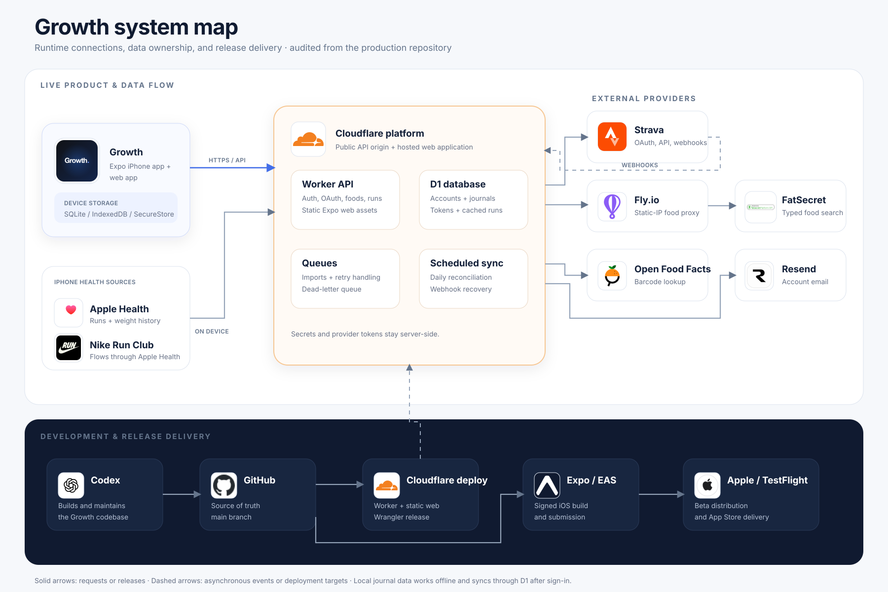

# Growth system map

## How to read it

- **Live product and data flow** shows the services involved while a person uses Growth.
- **Development and release delivery** shows how code reaches the web app and TestFlight.
- Solid arrows represent requests or releases. Dashed arrows represent asynchronous events or deployment targets.

## Audited connections

| From | To | Purpose |
| --- | --- | --- |
| Growth iPhone/web | Cloudflare Worker | Accounts, journal sync, Strava data, food lookup, and hosted web assets |
| Growth iPhone | Apple Health | Read-only running workouts and body-weight history |
| Nike Run Club | Apple Health | NRC workout source used by Growth on iPhone |
| Cloudflare Worker | D1 | Accounts, synchronized journals, sessions, encrypted Strava connections, and cached runs |
| Cloudflare Worker | Cloudflare Queues | Strava history imports, retries, and webhook processing |
| Cloudflare Worker | Strava | OAuth, activity API, deauthorization, and webhooks |
| Cloudflare Worker | Fly.io proxy | Authenticated food-search and detail requests from a static egress IP |
| Fly.io proxy | FatSecret | Typed food search and serving nutrition |
| Cloudflare Worker | Open Food Facts | Barcode product lookup |
| Cloudflare Worker | Resend | Account verification and recovery email |
| Codex | GitHub | Development work committed to the Growth repository |
| GitHub | Cloudflare | Worker and Expo web deployment through Wrangler |
| GitHub | Expo/EAS | Signed production iOS builds |
| Expo/EAS | Apple/TestFlight | Beta and App Store distribution |

The synchronized journal works locally first. Before sign-in, iPhone and browser data remain separate. After sign-in, the journal synchronizes through the Worker and D1. Apple Health data stays on the iPhone until Growth reads it; Strava runs are cached server-side for the linked Growth account.
